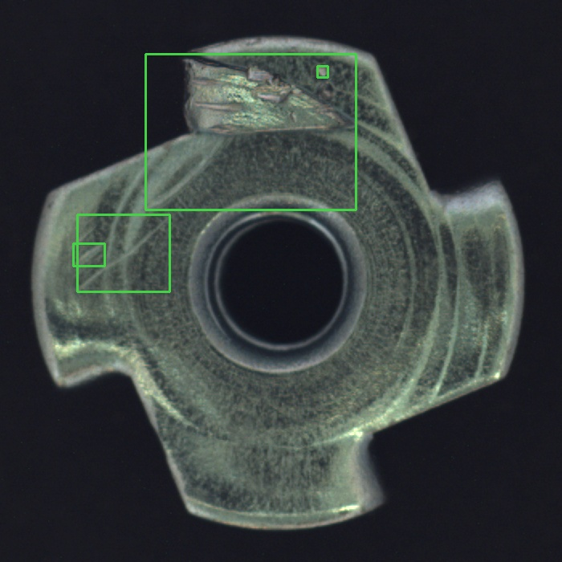
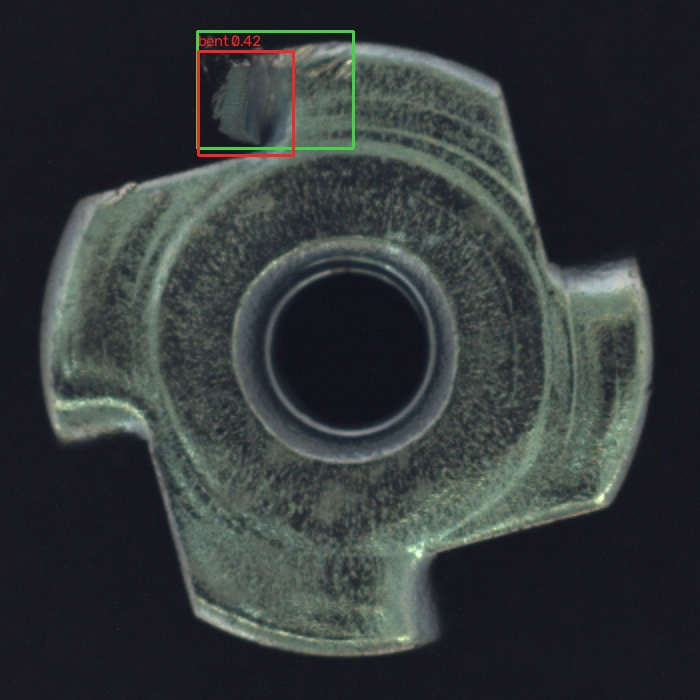
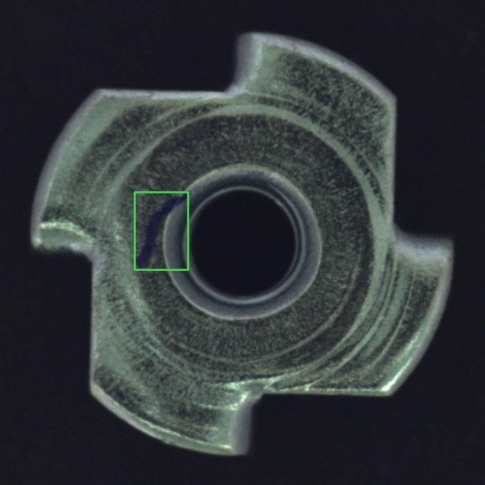
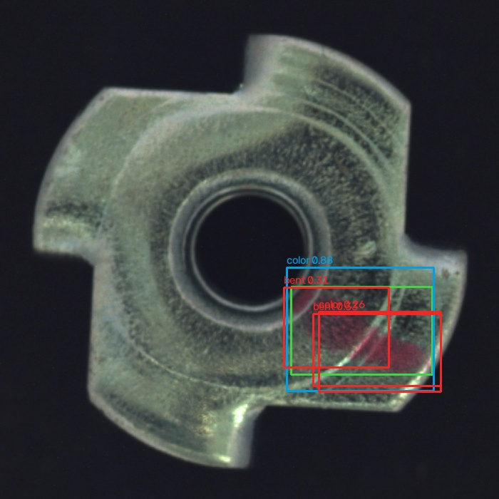
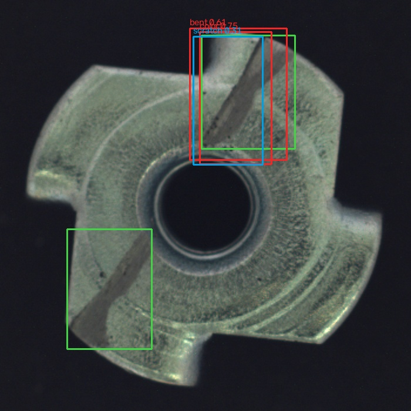

# EdgeInspect — Metal Nut Defect Detection

Independent InSiSo computer-vision internship take-home by Hargun Madan.

**Status: experiments, ONNX, CPU benchmark and technical write-up completed.**

Selected test results: precision **0.3438**, recall **0.4074**, mAP@0.5 **0.5182**. These are modest localization results, not production-readiness claims. The [complete take-home write-up](#take-home-write-up) below includes the approach, results, five reviewed failures, improvement experiment and answers A/B/C.

**Quick demo:** run start.ps1 from a normal PowerShell terminal, then open http://127.0.0.1:8000. The packaged ONNX model runs locally. Real good/flipped sample images are included.

## Submission files

- [Complete take-home write-up in this README](#take-home-write-up), also available as [docs/REPORT.md](docs/REPORT.md)
- [ONNX model](artifacts/metal-nut.onnx) and [selected PyTorch weights](artifacts/best-model.pt)
- [Model card](docs/MODEL_CARD.md), [measured CPU benchmark](artifacts/benchmark.json), and [test results](artifacts/onnx_test.json)

## What this project does

Converts MVTec AD metal_nut masks to boxes, trains a small four-class YOLO11n detector, evaluates localization, exports ONNX, benchmarks a CPU-only runtime, and serves a local React inspection workspace. The demo supports uploaded images, real detection overlays, a threshold control, measured runtime breakdown, experiment results, and in-memory history.

Python handles vision and FastAPI; React handles the UI. A database and an Express proxy would not improve this assignment, so they are intentionally absent. Once dependencies and weights are installed, inference stays local.

## Reproduce in a separate workspace (Windows PowerShell)

The published project includes completed runs, a frozen model selection and final test results. Training and selection deliberately refuse to overwrite those files. For a new experiment, first create a sibling workspace containing the source and configuration. Run this block from the downloaded project's root. It copies the files needed for training and evaluation; all new data, runs and results will be created in the new workspace.

~~~powershell
$submissionRoot = (Get-Location).ProviderPath
$reproductionRoot = Join-Path (Split-Path -Parent $submissionRoot) 'EdgeInspect-reproduction'
if (Test-Path -LiteralPath $reproductionRoot) {
    throw 'EdgeInspect-reproduction already exists. Choose a new, empty workspace name.'
}
New-Item -ItemType Directory -Path $reproductionRoot -ErrorAction Stop | Out-Null
$sourceItems = @('src', 'tests', 'docs', 'requirements.txt', 'requirements-runtime.txt',
                 'train-gpu.ps1', 'LICENSE', 'THIRD_PARTY_NOTICES.md')
foreach ($item in $sourceItems) {
    Copy-Item -LiteralPath (Join-Path $submissionRoot $item) -Destination $reproductionRoot -Recurse -ErrorAction Stop
}
Set-Location -LiteralPath $reproductionRoot
~~~

Run setup and numbered steps 1-4 below from this new workspace. Its `runs/`, `artifacts/` and `data/prepared/` start absent, so the overwrite guards allow a new experiment. Use the original downloaded project for the inspection UI and its supplied models.

## Setup

Use Python 3.11 or 3.12 if dependency wheels are unavailable for your Python version.

~~~powershell
python -m venv .venv
.\.venv\Scripts\python -m pip install --upgrade pip
.\.venv\Scripts\python -m pip install -r requirements.txt
~~~

Optional NVIDIA training: install an appropriate CUDA-enabled PyTorch wheel from https://pytorch.org/get-started/locally/ before the remaining dependencies. CPU training is supported. The discovered development GPU was a GTX 1650 (4 GB); both completed training runs used this GPU.

If environment creation fails at ensurepip, try Python 3.12 from an ordinary terminal. Do not assume the partially created environment works.

## 1. Get the data and create labels

Download the **metal_nut** category from the official MVTec AD page:
https://www.mvtec.com/research-teaching/datasets/mvtec-ad

Extract it to data/raw/metal_nut inside the reproduction workspace. Alternatively, the included downloader obtains the metal_nut mirror and the official pretrained weights, recording their source and checksums:

~~~powershell
.\.venv\Scripts\python -m src.download_assets
~~~

Expected structure:

~~~text
data/raw/metal_nut/
  train/good/*.png
  test/{good,bent,color,flip,scratch}/*.png
  ground_truth/{bent,color,flip,scratch}/*_mask.png
~~~

~~~powershell
.\.venv\Scripts\python -m src.prepare --raw data/raw/metal_nut
.\.venv\Scripts\python -m src.audit_labels
~~~

**Protocol:** MVTec's official training data has no defects. For this supervised assignment, pool images by category and make a custom stratified 60/20/20 train/validation/test split, seed 42. This repurposes some original test images for supervised training; it is not comparable to the official anomaly-detection benchmark. Remove exact byte duplicates before splitting. Keep the generated manifest fixed across experiments. Near-duplicate scenes may remain: exact hashes do not establish production independence. If capture IDs become available, split by physical part/capture session instead.

Every nonzero connected mask component becomes one tight, axis-aligned box. Preserve tiny components rather than silently filtering hard labels. Pixel coordinates use exclusive maximum edges. Good parts have empty label files. Defect class order is bent, color, flip, scratch. The source folder supplies class identity. Disconnected components may represent one physical defect, and flipped parts may have large masks: review the label contact sheet before training. Boxes discard mask shape and include background; discuss this limitation.

The audit writes label_preview.jpg and split_audit.json. Verify every class in every split, tiny boxes, flipped-part masks, and data quality. Changing label policy requires a new frozen dataset version.

## 2. Train a baseline and one improvement

The measured experiments used CUDA device 0, batch 4, two CPU threads and a maximum of 30 epochs. After configuring CUDA-enabled PyTorch, run the following in the reproduction workspace:

~~~powershell
.\.venv\Scripts\python -m src.train --experiment baseline --device 0 --batch 4 --epochs 30 --threads 2
.\.venv\Scripts\python -m src.train --experiment augmented --device 0 --batch 4 --epochs 30 --threads 2
~~~

For CPU training, replace `--device 0` with `--device cpu` in both commands and retain `--batch 4`. The training CLI's default batch is 8, so the explicit batch argument is necessary to match the reported configuration. Reduce the batch only as a separately documented experiment, keeping both arms identical. Initialization is pretrained yolo11n.pt; input is 320x320, seed 42, AdamW and early stopping patience 15. The best checkpoint is selected using validation performance by the training framework. Hardware/software differences can change timing and numerical results; disclose actual epochs and elapsed time.

As an alternative to the manual training, validation and finalization commands, run `train-gpu.ps1` in the new workspace after preparing the data. It installs/checks the CUDA stack and runs the entire pipeline with GPU batch 4. Run either the wrapper or the manual path. Running the wrapper in the original submission will reuse its completed results instead of starting new experiments.

**Improvement hypothesis:** mild geometric and lighting augmentation may reduce overfitting on limited defect images. Both arms use the same initialization, split and training budget; augmentation is the changed factor. Avoid aggressive hue shifts because color is itself a defect class. Neither arm uses mosaic. A single seed is an exploratory comparison, not statistically reliable proof. If augmentation hurts validation results, report that honestly and select the baseline.

## 3. Validate, freeze selection, then evaluate

~~~powershell
.\.venv\Scripts\python -m src.evaluate --model runs/baseline/weights/best.pt --name baseline_val
.\.venv\Scripts\python -m src.evaluate --model runs/augmented/weights/best.pt --name augmented_val
.\.venv\Scripts\python -m src.select
~~~

Selection uses higher validation mAP@0.5; a tie favors the simpler baseline. The operating threshold remains predeclared at 0.25. The validation threshold sweep is diagnostic only. To change the threshold, document a validation-only decision before touching test. Never select it from test results.

~~~powershell
.\.venv\Scripts\python -m src.finalize
~~~

This runs selected-model test evaluation, ONNX export, benchmark and ONNX test evaluation. It refuses to overwrite an existing selection or final result, so the final test cannot silently become a tuning loop. If a run is interrupted, complete its remaining commands manually after inspecting which outputs already exist.

Metrics are class-aware with one-to-one greedy matching at IoU >=0.5. Precision/recall are micro-aggregated counts at the fixed confidence threshold. AP uses all-points interpolated area under the confidence-ranked precision–recall curve, then macro-averages classes with ground truth. Predictions are collected down to confidence 0.001; AP below that floor is unmeasured. This AP implementation is not COCO's 101-point convention. Report the convention with the numbers. Good images contribute false positives. Report per-class AP and counts, not just an aggregate.

False positives/misses generate overlays in artifacts/failures. Green = ground truth, red = false positive, blue = matched prediction. Visually inspect at least five **distinct held-out images**, then replace each selected case's pending analysis in docs/REPORT.md with an observation and a clearly qualified causal hypothesis. If there are fewer than five errors at the frozen operating point, report all of them and transparently inspect an additional prespecified stress/shift set; do not invent misses or tune on test to generate them.

## 4. ONNX export and CPU benchmarking

The finalizer calls src.export_benchmark. For a manual run:

~~~powershell
.\.venv\Scripts\python -m src.export_benchmark --model runs/augmented/weights/best.pt --threads 1 --iterations 100
~~~

The published selection is the augmented checkpoint shown above. For a new experiment, use the model path in its artifacts/selection.json. Finalization already performs export and benchmarking; the manual command is an alternative for an unfinished export stage. The exported artifact is artifacts/metal-nut.onnx: FP32, fixed batch 1, 320 x 320, opset 17. The runtime uses ONNX Runtime CPUExecutionProvider, RGB conversion, letterboxing, /255 normalization, and class-aware NMS.

The benchmark records CPU name, OS, runtime version, thread count, model size, 20 warmups, 100 iterations, and mean/p50/p95 for preprocessing, model execution, postprocessing and total. Images are preloaded. File loading/decoding, HTTP and display are excluded. GPU inference is never substituted for the required CPU timing. Repeated runs on different CPUs are not directly comparable.

The exporter records a decoded-detection count smoke check against PyTorch, not a proof of numerical parity. Finalization also evaluates ONNX through the **same custom runtime used by the demo**, for a real deployment accuracy check. Inspect any accuracy change before submitting.

## 5. Run the inspection UI

Use the original downloaded project for these commands. If you followed the workspace block above, return with `Set-Location -LiteralPath $submissionRoot`. The source-only reproduction workspace contains the training/evaluation files; the original project also contains the built frontend and supplied models. Create an environment in that directory using the inference-only installation below before starting the UI.

~~~powershell
.\.venv\Scripts\python -m uvicorn src.api:app --host 127.0.0.1 --port 8000
~~~

In another terminal:
~~~powershell
cd web
npm install
npm run dev
~~~

Open http://127.0.0.1:5173. If no weights exist, the UI shows the missing-model state; inference returns HTTP 503. Upload PNG/JPEG up to 10 MiB and 16 megapixels. Detection boxes are in original-image coordinates. The API corrects EXIF orientation. The UI uses the same correction in modern browsers; use upright, orientation-free dataset images for the demo.

Production preview: run npm run build inside web, then restart FastAPI and open http://127.0.0.1:8000. The frontend uses relative API URLs, so this is a single local origin. Google Fonts is optional; system fonts keep the interface usable offline. No inference or image upload uses an external service. Session history is in memory; reloading clears it.

“No defect detected” is a model observation, not a guarantee of a good part. This demo is not a certified production reject controller. Threshold changes clear the displayed prediction so an old result cannot appear to use a new threshold.

## Validation

~~~powershell
python -m unittest discover -s tests -v
python -m compileall -q src
.\.venv\Scripts\python -m src.check_submission
~~~

Metric and selection tests are dependency-free; the complete test suite requires the installed vision/API dependencies. Training, mask conversion, export and inference were executed; see the verification status for the exact API/browser test scope. See docs/STATUS.md for what was actually executed.

## Deliverables and submission

- Code and reproduction instructions in this repository.
- docs/REPORT.md: approach, results, five reviewed failures, experiment conclusion and written answers A/B/C.
- artifacts/metal-nut.onnx (or a release/download link). Large model artifacts should go in a GitHub release or Git LFS.
- artifacts/selection.json, benchmark.json, *_val.json and *_test.json, plus frozen manifest/split audit and environment versions.
- Optional 2-minute recording: explain split, compare baseline/improvement, inspect one failure, run local inference, show CPU timings.
- Reply in the original email thread with the GitHub link, studying status/year, and your confirmed earliest start date.

**AI disclosure:** Codex assisted with implementation, evaluation design, documentation and the UI. Training results must come from actual runs. The applicant should review and explain every submitted component. See docs/INTERVIEW.md.

## Attribution

Dataset: Paul Bergmann et al., MVTec AD. CC BY-NC-SA 4.0, non-commercial use. Do not redistribute the dataset casually; prefer download instructions and image IDs. Review image licensing before posting failure overlays publicly.
Model/framework: Ultralytics YOLO11, pretrained on COCO. Review Ultralytics' AGPL-3.0 / enterprise terms for distribution and any future commercial use.
Design direction: industrial edge-vision workflows and InSiSo's Develop / Evaluate / ONNX / local deployment emphasis. EdgeInspect is independent, uses its own name, and does not claim to be InSiSoNet or an official company product.

## Included measured submission

See docs/REPORT.md, docs/MODEL_CARD.md and docs/SUBMISSION.md. Models are in artifacts/; selected weights and ONNX checksums are in artifacts/model_checksums.json. Five reviewed failure overlays are in docs/images/. The original decoder results are retained as *_decoder_v1.json; the current decoder corrects NMS/clipping order. No test-driven model/threshold change was made.

## Inference-only installation

For a smaller installation that does not need PyTorch, create the environment and install requirements-runtime.txt, then run start.ps1. The ONNX model and sample images are included; training is optional for using the demo.

## Take-home write-up

Hargun Madan | InSiSo computer-vision internship take-home | 25 October 2026

### Result and practical limits

A four-class YOLO11n detector was trained on a custom supervised MVTec AD metal_nut split and exported to a local CPU ONNX runtime. Augmentation raised validation mAP@0.5 from 0.3893 to 0.4628. The selected ONNX model achieved **mAP@0.5 0.5182, precision 0.3438, recall 0.4074** at confidence 0.25 and IoU 0.5 on 69 held-out images.

These are modest results, not production-readiness claims. The model misses 16 of 27 annotated components and produces 21 extra boxes. At the simpler image-alarm level it flags 16/20 defective images and falsely flags 0/49 good images, but this does not establish a reliable industrial false-alarm rate: the test is small and four defective parts still escape. Part-level alarm performance must not be substituted for localization recall.

### Labels and split

Each connected, nonzero pixel-mask component becomes one tight axis-aligned box with exclusive maximum pixel coordinates. The folder supplies bent/color/flip/scratch class identity; good images get empty label files. All components are kept. I visually reviewed the training label contact sheet before training.

This policy is deterministic, but disconnected fragments are counted as separate detection instances even when they belong to one physical defect. It can create several nearby or overlapping boxes, while flip masks usually cover the whole part. Thus the metric reflects the declared component-label policy, not a guaranteed count of physical defect events. A future labeling study should agree on physical defect instances with an inspector before evaluating a revised policy.

MVTec's original training split has only good parts. For supervised detection, I repurposed some original test images into training and validation, after deduplicating exact image bytes and making a seed-42, stratified 60/20/20 split. **This is not the official unsupervised MVTec protocol and is not comparable to its anomaly benchmark scores.** Exact hashes do not rule out near duplicates; capture-session/physical-part grouped evaluation is the next safeguard if those IDs become available. Training augmentation happens after the split. Selection uses validation only.

| Split | Good | Bent | Color | Flip | Scratch | Total |
|---|---:|---:|---:|---:|---:|---:|
| Train | 145 | 15 | 13 | 13 | 13 | 199 |
| Validation | 48 | 5 | 4 | 5 | 5 | 67 |
| Test | 49 | 5 | 5 | 5 | 5 | 69 |

### Controlled experiment and results

Both arms start from the same official COCO-pretrained yolo11n.pt, seed 42, input 320x320, batch 4, FP32, AdamW at initial learning rate 0.001, at most 30 epochs and patience 15. Training ran on an NVIDIA GeForce GTX 1650 (4 GB). The first CPU attempt was interrupted during epoch one without a usable checkpoint; it is not an experiment result. Before comparing validation results, the completed runs were configured with the same GPU budget. The baseline stopped after 28 epochs and augmentation after 29.

| Run | Split | Precision | Recall | mAP@0.5 | TP / FP / FN |
|---|---|---:|---:|---:|---|
| Baseline | val | 0.6250 | 0.3125 | 0.3893 | 10 / 6 / 22 |
| Mild augmentation | val | 0.4783 | 0.3438 | 0.4628 | 11 / 12 / 21 |
| Selected PyTorch | test | 0.3438 | 0.4074 | 0.5182 | 11 / 21 / 16 |
| Selected ONNX | test | 0.3438 | 0.4074 | 0.5182 | 11 / 21 / 16 |

Precision and recall are micro-aggregated detection counts at confidence 0.25. Matching is one-to-one, class-aware and uses IoU >=0.5. AP uses all-points interpolated area under the ranked precision-recall curve, with predictions collected down to confidence 0.001; this is not COCO's 101-point convention. mAP is the macro average over classes with ground truth. Good images count toward false positives. The framework selects the checkpoint within each run using its validation fitness; the independent evaluator selects between the two best checkpoints by validation mAP@0.5, with ties favoring baseline. The diagnostic validation threshold sweep was not used to change the predeclared operating threshold.

#### Did the improvement work?

The changed factor is modest augmentation: +/-15-degree rotation, translation 0.05, scale 0.15, horizontal/vertical flips at probability 0.5, and small saturation/value changes. Mosaic and mixup stay off. Strong hue shifts are avoided because color is a defect class. Flip here means the nut is physically turned over; reflecting an image is not the same physical operation, but its realism still deserves validation.

Aggregate validation AP improved by **0.0735 absolute (7.35 percentage points)**, so the augmented checkpoint was selected before final-test evaluation. This is not a uniform win: validation precision fell from 0.6250 to 0.4783 while recall rose from 0.3125 to 0.3438. Bent and color AP increased, scratch AP fell from 0.1715 to 0.0400, and flip AP remained 1.0. The small validation sample and a single seed limit confidence in any causal claim. The augmentation may broaden pose/color coverage while harming subtle scratch cues; the class-specific results support investigating that tradeoff, not claiming a universal improvement.

#### Selected ONNX per-class test AP

| Class | Annotated components | AP@0.5 |
|---|---:|---:|
| bent | 9 | 0.2074 |
| color | 5 | 0.3233 |
| flip | 5 | 1.0000 |
| scratch | 8 | 0.5421 |

Flip masks are large and visually distinct; five positive examples are insufficient to infer production reliability. The aggregate score is partly driven by this easier class. Bent/color localization remain weak, and no test-driven retraining or threshold selection was performed.

### Export, runtime parity and CPU speed

The selected weights export to **FP32 ONNX, opset 17, fixed batch 1, 320x320**, 10.44 MB. ONNX checker passes. Deployment uses RGB conversion, letterboxing, division by 255 and class-aware NMS on CPUExecutionProvider.

Reference-versus-runtime checking found a decoder error: clipping boxes before NMS changed IoU and suppressed extra boundary boxes. I moved clipping after NMS, added a boundary regression test and rechecked deployment output. Training, checkpoint selection, labels and confidence were unchanged. Original decoder results are retained as *_decoder_v1.json. The final ONNX precision, recall and mAP now match the PyTorch test metrics. This is a deployment correction, not a model-improvement experiment or test-set threshold tuning.

CPU: **Intel(R) Core(TM) i5-10300H CPU @ 2.50GHz**, Windows 11, ONNX Runtime 1.23.1, one intra-op thread and one inter-op thread. Twenty warmup iterations precede 100 measurements over preloaded validation images. The following is the current-runtime benchmark, not a GPU timing.

| Stage | Mean ms | p50 ms | p95 ms |
|---|---:|---:|---:|
| preprocess | 1.99 | 1.99 | 2.62 |
| inference | 40.45 | 39.11 | 50.74 |
| postprocess | 1.18 | 1.00 | 1.80 |
| total | 43.62 | 41.81 | 55.19 |

Disk reading, decoding, HTTP, display and physical actuator timing are excluded. Laptop load and thermal state affect timings; the earlier benchmark is retained for traceability and is not presented as a controlled speedup. The model does not meet a 10 ms CPU budget on this machine.

### Five visually reviewed held-out failures

Green boxes are ground truth, red boxes are false positives, and blue/cyan boxes are matched predictions. The causes below are reasoned hypotheses based on visible evidence; the measured error type is separate from the hypothesis.

#### 1. test_bent_015 - Miss: 4 components

No detection above 0.25, despite visible damage on the upper lug and left edge.

Likely explanation: The damage spans several disconnected mask components and scales. Limited pose/defect examples may leave this appearance uncovered; this is a hypothesis, not an observed internal cause.

#### 2. test_bent_023 - Localization FP + miss

A bent prediction at confidence 0.420 covers only part of the upper-edge defect; IoU is 0.486, below the fixed 0.5 matching cutoff.

Likely explanation: The box follows the visually strongest notch but underestimates the annotated extent. This demonstrates why finding a defect-looking region is not sufficient for correct localization.

#### 3. test_color_004 - Miss: 1 component

The dark blue patch beside the inner ring has no prediction above the operating threshold.

Likely explanation: The relatively small, dark patch blends into the inner-rim shadow and metallic texture. More representative dark-color flaws and higher-resolution validation are plausible next experiments.

#### 4. test_color_013 - 3 extra detections

The red patch is correctly detected as color at confidence 0.878, but two bent boxes and a second color box remain as false positives.

Likely explanation: The same high-contrast region triggers multiple class heads. Class-aware NMS intentionally keeps different classes; partial boxes also escape same-class suppression. This is classification and duplicate-counting failure, not a missed red patch.

#### 5. test_scratch_018 - 2 FPs + 1 miss

The upper scratch is matched at confidence 0.307, but higher-scoring color (0.753) and bent (0.614) boxes overlap it. The separate lower-left scratch is missed.

Likely explanation: A dark scar can resemble staining or deformation, while the second scar has different orientation and local texture. The pattern suggests class ambiguity and incomplete coverage across multiple defects.

### Priorities before a factory pilot

Agree on physical-defect instance labeling, gather more independent bent/color/scratch examples, and validate by later production lot/shift. Compare higher resolution or a controlled part crop using a new validation-only experiment; do not choose changes from the final test. Evaluate false rejects at realistic prevalence, confidence calibration, tail latency and reject-actuator timing. The app reports REVIEW or NO_DEFECT_DETECTED rather than certifying PASS. For the limited-data and latency scenarios, the following answers describe broader options rather than unrun experiments.

### A. Only 30 defective images and 3,000 good images

I would first clarify the cost of a missed defect versus a false reject, the expected defect sizes, and whether those 30 images cover independent physical parts, lighting conditions and defect mechanisms. I would audit labels and remove duplicates, then reserve evaluation images by capture session or production lot. A random image split could leak almost identical views across training and evaluation. With very few positives I would report counts and uncertainty, including per-defect recall, rather than treating a high aggregate score as reliable.

The good images are useful data. I would establish a normal-only anomaly-detection baseline, for example a pretrained feature extractor with a compact normal-reference bank or a teacher/student normal model. The 30 defect images help assess localization, understand uncovered modes and tune an alarm threshold on validation data. A compact detector fine-tuned with conservative augmentation is a second baseline if localized defect examples are sufficient. Neither method can be assumed to cover unseen defect types. If an ensemble is considered, it must fit the measured runtime and reduce costly errors in independent evaluation.

I would augment only training images using physically plausible changes. Strong color shifts could hide color flaws; copied synthetic defects may introduce artifacts, so they should supplement genuine data and be validated separately. Extra views of one part remain grouped. I would collect additional real defects deliberately through controlled production sampling, ask an inspector to review uncertain and novel examples, and log the reason for each rejection. The operating threshold should reflect the customer’s miss/false-reject costs and review capacity. Evaluation must include a realistic stream of good parts: even a low false-positive rate can overwhelm the line when good parts dominate. Before automatic rejection, I would use a monitored pilot with human review, documented capture controls and a rollback plan.

### B. Good test scores, then missed defects after two weeks

1. **Contain and verify.** Preserve missed-part images, model outputs, timestamps and line settings; route uncertain production to manual inspection. Confirm that the failures are real defects, not changed acceptance criteria or label mistakes. The immediate aim is to prevent further escapes while preserving evidence.
2. **Inspect acquisition first.** Check focus, motion blur, exposure, gain, illumination, reflections, lens contamination, camera position and trigger timing. Compare current raw frames to training and commissioning frames. A mechanical or lighting change can produce a large shift without a software change.
3. **Check the complete deployed path.** Verify model checksum/version, class mapping, threshold, ROI, resize/letterbox, color order, normalization and quantization. Re-run saved missed images through both the deployed runtime and reference implementation. Inspect frame drops, stale frames and whether detections reached the PLC/reject actuator in time. Good offline detection cannot compensate for a late physical reject.
4. **Check production changes and drift.** Ask about material suppliers, finish, part geometry, defect size/type, speed, temperature and camera replacement. Compare image distributions and results by lot, shift and defect type. Random commissioning tests may have underrepresented the new conditions.
5. **Relabel and quantify.** Build a reviewed recent-data set containing misses, random good samples and difficult non-defects. Estimate per-class recall and false rejects under the actual operating point. Keep an independent holdout from later batches; avoid training and testing on the same rescue examples.
6. **Fix the demonstrated cause, then validate.** Restore capture settings for acquisition drift, repair integration bugs, or retrain with representative new data. Revisit the threshold using validation costs rather than blindly lowering it. Validate accuracy, latency and reject timing together, then shadow/canary the change, version it and monitor ongoing escapes with a rollback path.

### C. 10 ms budget, 40 ms model

First define whether 40 ms is model execution or the complete image-to-decision path, and whether the 10 ms limit is latency per part or steady-state throughput. Measure batch-1 p50/p95 on the actual controller after warmup, separating acquisition, preprocessing, model, postprocessing and actuator communication. CPU model and thread contention matter. Batching may improve throughput but increases individual latency and is usually inappropriate for a strict per-part deadline.

I would remove avoidable overhead first: reuse the loaded session and buffers, avoid repeated image conversions, use optimized runtime graph execution and tune CPU threads. Then compare a smaller detector or backbone, a smaller input or a tightly controlled part ROI. These reduce compute, but smaller inputs can erase scratches and small bent regions, so measure per-class recall and false rejects again. Reducing postprocessing candidates may save time if NMS is dominant; it cannot fix a 40 ms convolution bottleneck.

Next consider supported acceleration: a controller NPU, GPU, or vendor runtime such as OpenVINO where the hardware supports it. INT8 post-training quantization needs representative calibration data drawn from training, including real capture variation, and independent accuracy/latency evaluation; FP16 helps only on hardware with efficient support. If post-training quantization damages sensitive defects, quantization-aware training or distillation into a smaller model may help. Pruning requires a runtime that realizes the reduced computation; sparse weights alone do not guarantee lower latency.

A staged system could use a cheap part/quality gate and run a detector only when needed, but the worst-case defective image must still meet the deadline, and the gate's false negatives count as system misses. Frame skipping likewise risks missing short-lived defects. If an optimized, validated pipeline still cannot meet the hard 10 ms bound, I would propose better hardware or a redesigned station with adequate buffering and an agreed timing budget, rather than claiming that average FPS satisfies a hard deadline. Every speed change needs a measured accuracy tradeoff and a documented fallback.

### Reproduction and AI assistance

Follow README.md. Code, frozen split hashes, per-run configuration, raw predictions, metrics, failure overlays, ONNX, environment versions and a local React inspection UI are included in the submission package. Real model/API function checks and test results are listed in docs/STATUS.md.

Codex assisted with implementation, protocol design, documentation, debugging, visual failure review and the UI. The initial online setup and GPU pipeline were run in a normal terminal because the agent session restricts networking. All numerical results come from saved experiment outputs, not simulated values. The applicant must review and understand the submitted code and explain its decisions in the follow-up.

Applicant: Hargun Madan, currently studying B.Tech AI & ML at MSRIT, expected graduation May 2028. Availability belongs in the email reply, not the model evaluation.

### Sources and licensing

- MVTec AD: https://www.mvtec.com/research-teaching/datasets/mvtec-ad
- Ultralytics YOLO11: https://docs.ultralytics.com/models/yolo11/
- ONNX export: https://docs.ultralytics.com/integrations/onnx/
- ONNX Runtime: https://onnxruntime.ai/docs/performance/

MVTec AD images and derivatives are CC BY-NC-SA 4.0, for non-commercial use. The five annotated images above derive from MVTec AD, by Paul Bergmann et al.; annotations/overlays were added for this evaluation and retain the dataset's attribution and license. Full dataset bytes are not bundled. Project code is distributed under AGPL-3.0; see LICENSE and THIRD_PARTY_NOTICES.md. This is an independent take-home project, not an official InSiSo product.
